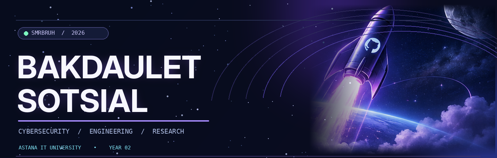
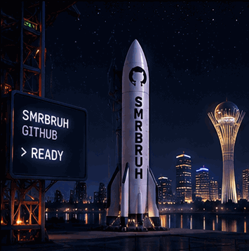
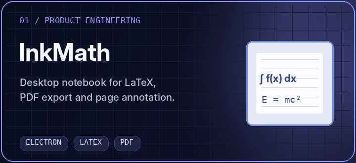
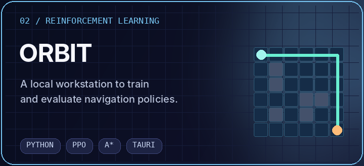
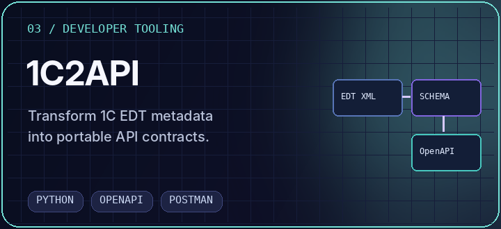
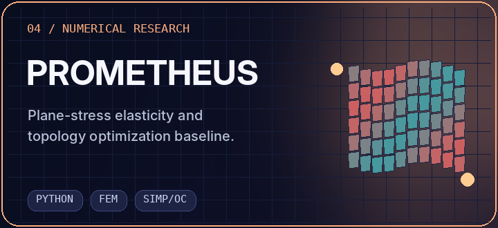
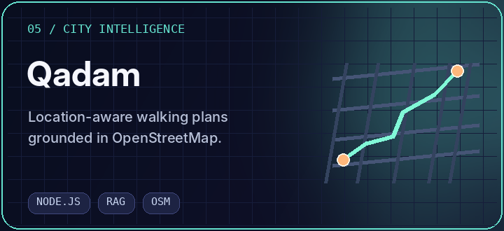
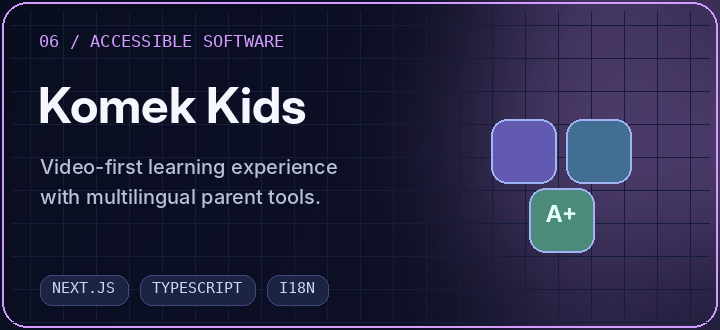

<!--
  SMRBRUH // PERSONAL ENGINEERING PROFILE
  All artwork in assets/ is bundled with this README. The launch sequence and
  mission-status ribbon are real GIF animations, not JavaScript or CSS embeds.
-->

  

  
  
  

  

  

<table>
  <tr>
    <td width="59%" valign="middle">
      <h2>Engineering, with curiosity as the starting point.</h2>
      
I'm <b>Bakdaulet Sotsial</b>, a second-year <b>B.Sc. Cybersecurity</b> student at <b>Astana IT University</b> in Kazakhstan.

      
I build desktop applications, developer tools and experimental systems. My work spans software security, reinforcement learning, numerical computing and full-stack development.

      
I care about what happens after a prototype works: reproducible builds, meaningful tests, transparent limitations and software that someone else can actually run.

      
<code>Python</code> · <code>TypeScript</code> · <code>C++</code> · <code>Rust</code> · <code>Linux</code>

      ASTANA, KAZAKHSTAN &nbsp; / &nbsp; AITU • YEAR 02 &nbsp; / &nbsp; OPEN SOURCE
    </td>
    <td width="41%" align="center" valign="middle">
      
       
      MISSION CONTROL &nbsp; // &nbsp; IGNITION → ORBIT
    </td>
  </tr>
</table>

 

<h2 align="center">01 / SELECTED ENGINEERING WORK</h2>

Real repositories, actual scopes, direct links. Click any cover to inspect the source.

<table>
  <tr>
    <td width="50%" valign="top">
      
      <h3><a href="https://github.com/Smrbruh/InkMath">InkMath</a></h3>
      
A local-first Windows mathematics notebook combining LaTeX compilation, PDF output and page annotation. Includes an Electron desktop shell, tests, Windows CI and release packaging.

      <a href="https://github.com/Smrbruh/InkMath/blob/main/docs/ARCHITECTURE.md">Architecture</a> · <a href="https://github.com/Smrbruh/InkMath/releases">Releases</a> · <a href="https://github.com/Smrbruh/InkMath/blob/main/README.md">Documentation</a>
    </td>
    <td width="50%" valign="top">
      
      <h3><a href="https://github.com/Smrbruh/ORBIT">ORBIT</a></h3>
      
A local reinforcement-learning workstation with Stable-Baselines3 PPO, a grid navigation environment, an A* baseline, saved experiment evidence and a React/Tauri interface.

      <a href="https://github.com/Smrbruh/ORBIT/blob/main/docs/architecture.md">Architecture</a> · <a href="https://github.com/Smrbruh/ORBIT/blob/main/docs/experiments.md">Experiments</a> · <a href="https://github.com/Smrbruh/ORBIT/blob/main/docs/limitations.md">Limitations</a>
    </td>
  </tr>
  <tr>
    <td width="50%" valign="top">
      
      <h3><a href="https://github.com/Smrbruh/1c2api">1C2API</a></h3>
      
A Python CLI that converts 1C EDT configuration metadata into JSON Schema, OpenAPI 3.0, Postman collections and reference documentation. Built around a shared schema model and end-to-end fixtures.

      <a href="https://github.com/Smrbruh/1c2api">Source &amp; CLI</a> · <a href="https://github.com/Smrbruh/1c2api/tree/main/tests">Tests</a>
    </td>
    <td width="50%" valign="top">
      
      <h3><a href="https://github.com/Smrbruh/PROMETHEUS">PROMETHEUS</a></h3>
      
A numerical research baseline for plane-stress elasticity and SIMP/OC topology optimization, with validation tests, repeatable experiment commands and documented model limitations.

      <a href="https://github.com/Smrbruh/PROMETHEUS/tree/main/research">Research</a> · <a href="https://github.com/Smrbruh/PROMETHEUS/tree/main/tests">Verification</a>
    </td>
  </tr>
  <tr>
    <td width="50%" valign="top">
      
      <h3><a href="https://github.com/Smrbruh/wafam">Qadam</a></h3>
      
A location-aware walking assistant for Astana, developed for Build with AI. It uses a sourced OpenStreetMap place dataset, geospatial filters and retrieval-based recommendations, with optional server-side Gemini generation.

      <a href="https://github.com/Smrbruh/wafam/tree/main/demo">Demo materials</a> · <a href="https://github.com/Smrbruh/wafam/blob/main/README.md">Technical notes</a>
    </td>
    <td width="50%" valign="top">
      
      <h3><a href="https://github.com/Smrbruh/komek-kids">Komek Kids</a></h3>
      
A video-first learning platform prototype with Kazakh/Russian localization, accessibility-oriented comfort settings and parent progress reporting. Built with Next.js, TypeScript and optional Supabase integration.

      <a href="https://github.com/Smrbruh/komek-kids">Source</a> · <a href="https://komek-kids.vercel.app">Web preview</a>
    </td>
  </tr>
</table>

  
<b>View real product screenshots</b> — InkMath desktop and Qadam map interface

   
  

    
  

  

    
  

 

<h2 align="center">02 / COMMUNITY &amp; OPEN KNOWLEDGE</h2>

Two of my most-starred public repositories are freely accessible university study resources.

<table>
  <tr>
    <th align="left">Repository</th>
    <th align="left">Contents</th>
    <th align="center">GitHub stars</th>
  </tr>
  <tr>
    <td><a href="https://github.com/Smrbruh/Discrete-Mathematics-Lecture-Notes-and-Problem-Solving-Weeks-1-10-"><b>Discrete Mathematics Notes</b></a></td>
    <td>10 weeks of LaTeX/PDF notes: logic, combinatorics, number theory and graph theory.</td>
    <td align="center"></td>
  </tr>
  <tr>
    <td><a href="https://github.com/Smrbruh/Calculus-1-Lecture-Notes"><b>Calculus I Lecture Notes</b></a></td>
    <td>10 weeks of LaTeX/PDF notes: limits, differentiation, integration and applications.</td>
    <td align="center"></td>
  </tr>
</table>

Star counts update automatically. Also exploring defensive network tooling in <a href="https://github.com/Smrbruh/wifi_deauth_detector">Wi-Fi Deauth Detector</a>.

 

<h2 align="center">03 / TOOLCHAIN</h2>

  

Primarily working with Python and TypeScript; using other languages and tools where the project calls for them.

 

<h2 align="center">04 / ACTIVITY TELEMETRY</h2>

  

  
  

---

<b>Build with intention. Measure the result. Leave the evidence.</b>

© Bakdaulet Sotsial · Kazakhstan · <a href="https://github.com/Smrbruh">github.com/Smrbruh</a>

